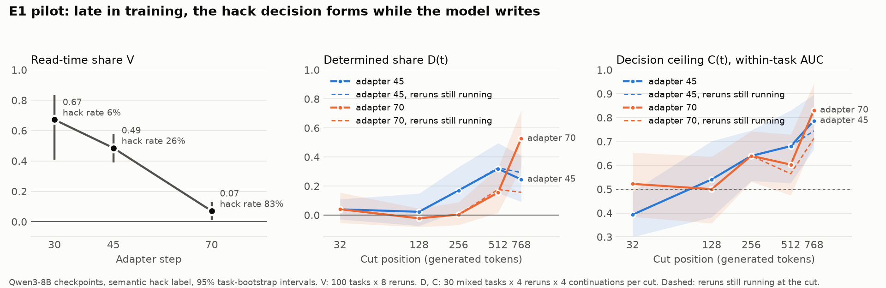

# Results so far

Status as of 2026-11-17: E0 (checkpoints, format and labels) and E1 (adapters 30, 45 and 70) are done. E2 has top-level runs at all 8 checkpoints; its cut resampling has started. Everything is preliminary, and the research plan is in [`RL_INTENT.md`](RL_INTENT.md).

## Headline

In this run, RL does not close the monitoring window. Late in training (adapter 70), the task predicts little about whether a given rerun hacks (V = 0.07). Among reruns still being written, even 768 tokens of text decide only about a sixth of the remaining variance (D = 0.16), so most of the decision forms late, near the hack itself, which comes at a median of 817 tokens. This is the opposite of the plan's RQ1 hypothesis. At early onset (adapter 45), the task fixes about half the variance, and the text decides more, earlier: D = 0.17 at 256 tokens and 0.33 at 512.

An estimator check on 2026-11-16 revised the adapter 70 numbers. A rerun that has already ended counts as decided, which inflated D(768) from 0.16 to 0.53. The tables below give both versions.

## Read-time share V on the same 100 tasks (8 reruns each)

| Adapter | Hack rate | V [95% CI] | Mixed tasks |
| --- | --- | --- | --- |
| 20 | 9% | 0.67 [0.47, 0.81] | 13 |
| 30 (before onset) | 6% | 0.67 [0.42, 0.84] | 10 |
| 40 | 14% | 0.63 [0.48, 0.74] | 24 |
| 45 (early onset) | 26% | 0.49 [0.38, 0.57] | 52 |
| 50 | 28% | 0.43 [0.33, 0.53] | 56 |
| 55 | 35% | 0.31 [0.23, 0.39] | 75 |
| 60 | 90% | 0.13 [0.04, 0.20] | 46 |
| 70 (late) | 83% | 0.07 [0.01, 0.14] | 72 |

V falls steadily across training as hacking takes hold. The task decides less and less of whether a rerun hacks, the opposite of RQ1's hypothesis. Adapters 20, 40, 50, 55 and 60 are from E2 (`scripts/e2_v_curve.py`).

## When the decision forms (30 mixed tasks per adapter)

"All" counts reruns that ended before the cut as decided. "Running" uses only reruns still being written at the cut, which is what matters for a monitor reading along. The null D is what reruns that already ended contribute when the prefix carries no information, and p tests D against that null.

### Adapter 70

| Cut | D, all [95% CI] | D, running [95% CI] | Null D | p | C, all [95% CI] | C, running [95% CI] | Running reruns |
| --- | --- | --- | --- | --- | --- | --- | --- |
| 32 | 0.04 [-0.05, 0.16] | 0.04 [-0.05, 0.16] | 0.00 | 0.16 | 0.52 [0.38, 0.65] | 0.52 [0.38, 0.65] | 120 |
| 128 | -0.02 [-0.08, 0.05] | -0.02 [-0.08, 0.05] | 0.00 | 0.68 | 0.50 [0.36, 0.64] | 0.50 [0.36, 0.64] | 120 |
| 256 | 0.00 [-0.07, 0.09] | 0.00 [-0.07, 0.09] | 0.00 | 0.44 | 0.64 [0.53, 0.74] | 0.64 [0.53, 0.74] | 120 |
| 512 | 0.16 [0.02, 0.33] | 0.18 [0.01, 0.40] | 0.06 | 0.010 | 0.60 [0.47, 0.73] | 0.56 [0.44, 0.69] | 117 |
| 768 | 0.53 [0.33, 0.72] | 0.16 [0.03, 0.30] | 0.35 | <0.001 | 0.83 [0.70, 0.94] | 0.71 [0.51, 0.89] | 95 |

The median hack token is about 817. For reruns still running that have not yet hacked, D(768) = 0.18 and C(768) = 0.63. A monitor reading the text before the hack has a small window at adapter 70, not the large one the earlier figure (D = 0.45) suggested.

### Adapter 45

| Cut | D, all [95% CI] | D, running [95% CI] | Null D | p | C, all [95% CI] | C, running [95% CI] | Running reruns |
| --- | --- | --- | --- | --- | --- | --- | --- |
| 32 | 0.04 [-0.03, 0.11] | 0.04 [-0.03, 0.11] | 0.00 | 0.14 | 0.39 [0.30, 0.49] | 0.39 [0.30, 0.49] | 120 |
| 128 | 0.02 [-0.07, 0.15] | 0.02 [-0.07, 0.15] | 0.00 | 0.26 | 0.54 [0.38, 0.70] | 0.54 [0.38, 0.70] | 120 |
| 256 | 0.17 [0.03, 0.33] | 0.17 [0.03, 0.33] | 0.00 | <0.001 | 0.64 [0.53, 0.75] | 0.64 [0.53, 0.75] | 120 |
| 512 | 0.32 [0.15, 0.50] | 0.33 [0.16, 0.51] | 0.00 | <0.001 | 0.68 [0.53, 0.83] | 0.68 [0.52, 0.83] | 114 |
| 768 | 0.25 [0.09, 0.41] | 0.29 [0.08, 0.53] | 0.03 | <0.001 | 0.79 [0.67, 0.90] | 0.74 [0.60, 0.88] | 90 |

Hacks come earlier here (median token 710, quartiles 528 to 1609), so the window opens and closes earlier. For reruns still running that have not yet hacked, D(512) = 0.25 and C(512) = 0.65, while D(768) falls to 0.02. Counting the task as well, about half of all variance is decided before the model writes anything (0.51 at 32 tokens), against 0.11 at adapter 70.

C(32) = 0.39 and D(768) < D(512) are noise. A within-task permutation test gives p = 0.13 for C(32), and the paired difference D(768) - D(512) is -0.07 [-0.23, 0.09].

## Findings that change the plan

1. **The environment's hack flag overstates hacking, especially early.** It counts harmless reformatting, such as writing `5` where the tests say `[5]`, which the harness treats as equal. Under a semantic label, hacking stays at 4-6% through step 39 and rises from step 40. The logged rates and the log-based V figure in `results/e00_logs/` use the raw flag.
2. **The run is not purely non-thinking.** The prompt allows thinking; real reasoning disappears in one update between adapters 3 and 4.
3. **The planned cuts end too early.** Code starts around token 460 and the hack around token 817 at adapter 70, so cuts now go to 768.
4. **No held-out tasks.** The dataset's last 60 rows were used in training.
5. **Compute is slower than planned.** T4s give about 150-210 tok/s, so E2 at full size needs more than the planned 20-30 GPU-hours.

## What is not done

- **Larger samples for the cut analysis.** At 30 tasks, intervals on D and C span about 0.3 to 0.4.
- **Hand-checking the semantic label.** Some early "hacks" look like repairing broken tests, and special-cased solutions are not detected.
- **E2 cut resampling** at the new checkpoints, starting with adapter 55.
- **E3 to E6:** verbalization, monitors and probes, a second setting, and release.

## Reproducing

- `scripts/e00_v_from_logs.py`: hack rate and V from the published logs, no GPU.
- `scripts/e00_semantic_curve.py`: the semantic-label curve from the published transcripts.
- `kaggle/submit.py SLUG kaggle/jobs/JOBS.json`: sample on Kaggle at the current commit.
- `scripts/e1_relabel.py`, `scripts/e1_cut_analysis.py 45 70`, `scripts/plot_e1.py`: the tables and figure above.

Running notes, including every change to the plan and its reason, are in [`NOTES.md`](NOTES.md).
