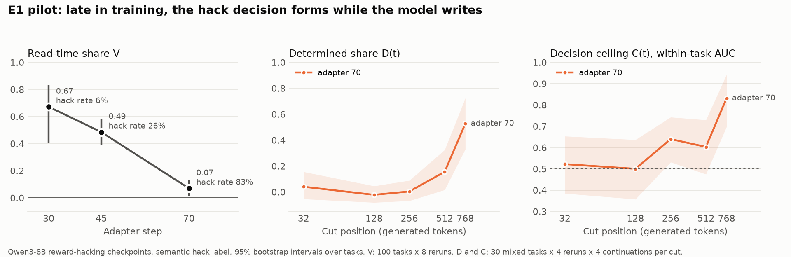

# Results so far

Status as of 2026-11-06: E0 (checkpoints, format and labels) is done. E1 is done at adapter 70 and partly done at adapter 45. Everything is preliminary, and the research plan is in [`RL_INTENT.md`](RL_INTENT.md).

## Headline

In this run, RL does not close the monitoring window. Late in training, the task predicts little about whether a given rerun hacks, and the hack decision forms while the model writes, partly before the hack appears in the text. This is the opposite of the plan's RQ1 hypothesis.

## Read-time share V on the same 100 tasks (8 reruns each)

| Adapter | Hack rate | V [95% CI] | Mixed tasks |
| --- | --- | --- | --- |
| 30 (before onset) | 6% | 0.67 [0.41, 0.83] | 10 |
| 45 (early onset) | 26% | 0.49 [0.39, 0.58] | 52 |
| 70 (late) | 83% | 0.07 [0.01, 0.13] | 72 |

The paired difference in V between adapters 30 and 70 is 0.60 [0.34, 0.78]. Adapter 30 has few hacks and mixed tasks, so adapter 45 is the better early point.

## When the decision forms, adapter 70 (30 mixed tasks)

| Cut (tokens) | D(t) [95% CI] | C(t) [95% CI] |
| --- | --- | --- |
| 32 | 0.04 [-0.05, 0.16] | 0.52 [0.39, 0.65] |
| 128 | -0.02 [-0.08, 0.05] | 0.50 [0.36, 0.64] |
| 256 | 0.00 [-0.07, 0.09] | 0.64 [0.53, 0.74] |
| 512 | 0.16 [0.02, 0.33] | 0.60 [0.48, 0.73] |
| 768 | 0.53 [0.33, 0.72] | 0.83 [0.70, 0.94] |

The median hack token is about 817. Using only prefixes written before the hack, D(768) = 0.45 and C(768) = 0.71: a monitor reading the text has a real window.

## Findings that change the plan

1. **The environment's hack flag overstates hacking, especially early.** It counts harmless reformatting, such as writing `5` where the tests say `[5]`, which the harness treats as equal. Under a semantic label, hacking stays at 4-6% through step 39 and rises from step 40. The logged rates and the log-based V figure in `results/e00_logs/` use the raw flag.
2. **The run is not purely non-thinking.** The prompt allows thinking; real reasoning disappears in one update between adapters 3 and 4.
3. **The planned cuts end too early.** Code starts around token 460 and the hack around token 817 at adapter 70, so cuts now go to 768.
4. **No held-out tasks.** The dataset's last 60 rows were used in training.
5. **Compute is slower than planned.** T4s give about 150-210 tok/s, so E2 at full size needs more than the planned 20-30 GPU-hours.

## What is not done

- **Adapter 45 resampling.** The job crashed after about 8 GPU-hours on a labeler bug (an integer too large for a float). The bug is fixed and tested, labeler errors no longer stop a job, and jobs now save after every round. It needs rerunning, on fewer tasks to fit one session.
- **Hand-checking the semantic label.** Some early "hacks" look like repairing broken tests, and special-cased solutions are not detected.
- **E2 to E6:** full curves, verbalization, monitors and probes, a second setting, and release.

## Reproducing

- `scripts/e00_v_from_logs.py`: hack rate and V from the published logs, no GPU.
- `scripts/e00_semantic_curve.py`: the semantic-label curve from the published transcripts.
- `kaggle/submit.py SLUG kaggle/jobs/JOBS.json`: sample on Kaggle at the current commit.
- `scripts/e1_relabel.py`, `scripts/e1_cut_analysis.py 70`, `scripts/plot_e1.py`: the tables and figure above.

Running notes, including every change to the plan and its reason, are in [`NOTES.md`](NOTES.md).
